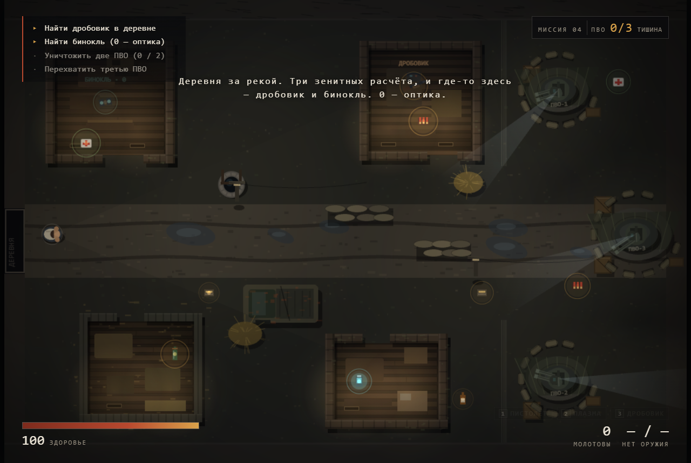
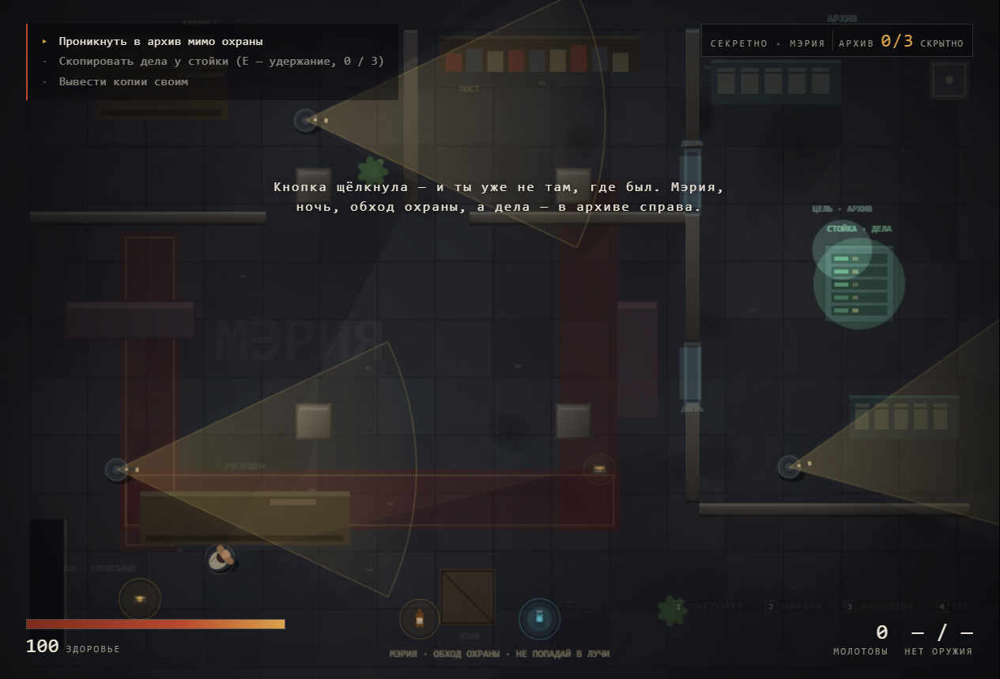
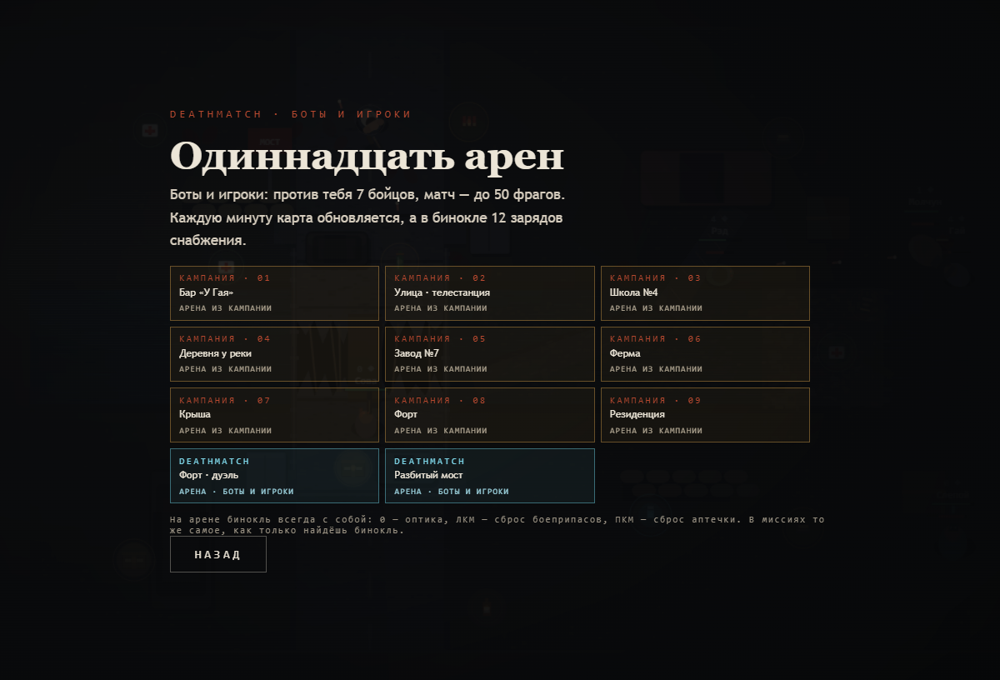
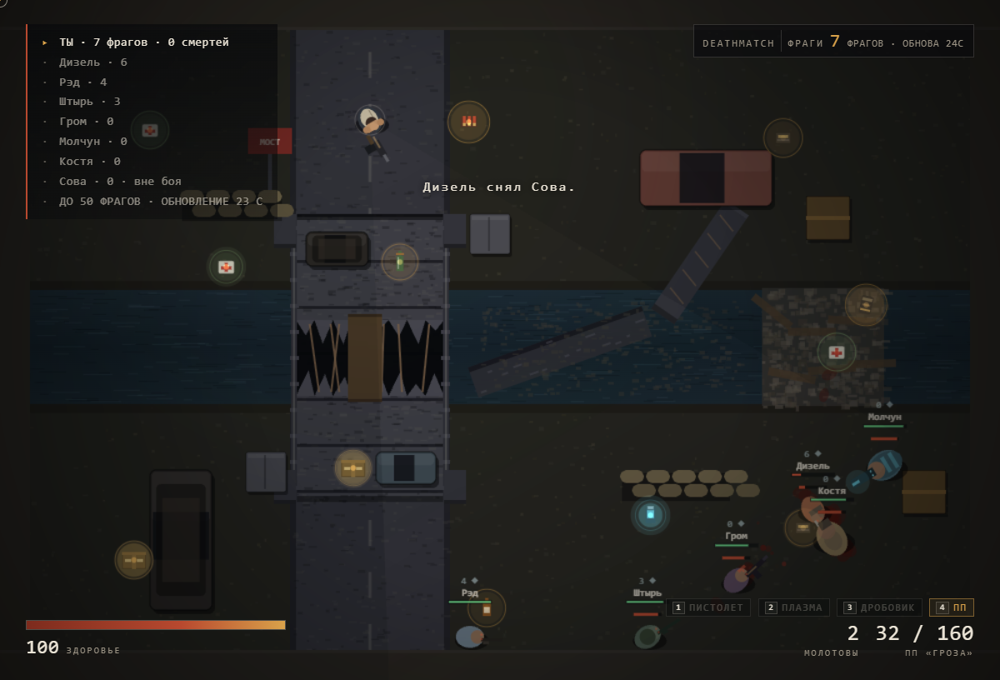
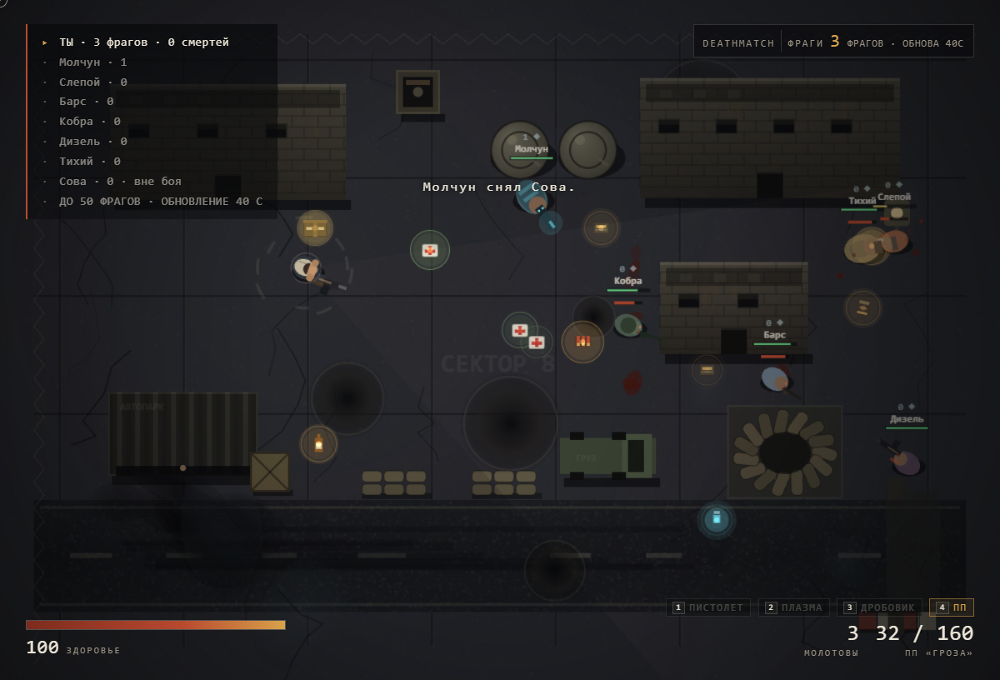
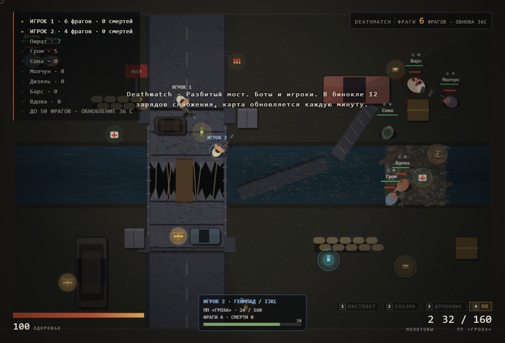
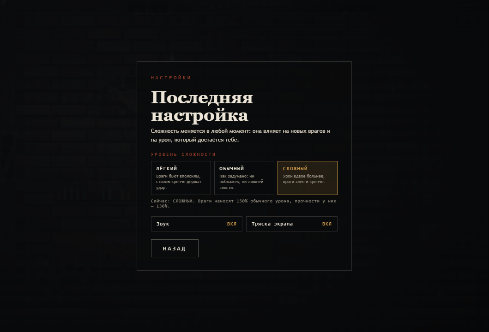

# Последний заказ · WORLD OF WARS

Девять миссий одного вечера: ты — Марк, бармен, просыпаешься в разгромленном баре посреди войны.

**Миссия 01 · «У Гая»** — найти пистолет под стойкой, собрать три бутылки спирта,
отбить три волны мародёров и уйти через чёрный ход.

**Миссия 02 · Улица** — за дверью лежит плазменный бластер. Дождь, разбитые машины,
три заслона. Задача — дойти до телестанции в конце улицы и войти в эфир.

**Миссия 03 · Последний заказ** — через сутки тебя записывают в штурмовую группу.
Ночь, школа №4: высадка через пролом в крыше, коридоры, охрана во дворе.
В спортзале за решёткой держат троих своих — сначала клетка, потом приёмное
отделение больницы за двором.

**Миссия 04 · Последний заказ** — деревня за рекой и три зенитных расчёта. Две
установки надо уничтожить, третью (командную) — перехватить, удержав **E** у пульта.
В избах лежат дробовик и бинокль: оптика на **0** увеличивает дальность обзора
вперёд, но по сторонам ты слепнешь.

**Миссия 05 · Последний заказ · завод №7** — город на востоке и три рубежа: переулок,
проходная, цех. На сборке в цеху лежит **ПП «Гроза»**: магазин на 32 патрона и очередь,
которая прошивает двоих врагов в ряд. Патроны — в трёх ящиках рядом с прессом.
Завод охраняют **штурмовики с таким же ПП** — по одному на каждый рубеж. Забрал
оружие и патроны — уходи к эвакуации в дальнем конце цеха.

**Миссия 06 · Последний заказ · ферма** — рассвет, ферма у реки и три колонны на пашне.
Бинокль (**0**) превращается в сетку наводки: наведи метку и нажми **ЛКМ** — борт
положит три бомбы по цели (восемь заходов). Накрыл колонны — забери ящик с патронами
в **овчарнике** и затащи его в вертолёт на площадке, удерживая **E**. Взлетели — заказ закрыт.

**Миссия 07 · Последний заказ · крыша** — высадка прямо на крышу многоэтажки. С неё
бьют **два миномёта**: снеси оба, спустись по лестнице в надстройке на **девятый этаж**,
забери у **E** три ящика — **патроны, топливо, снаряды** — и затащи их в борт на площадке
(по одному: с ящиком в руках ты не стреляешь и идёшь медленно). Перед вылетом на базе
можно **нанять отряд**: штурмовики идут следом и простреливают этаж, снайпер снимает
охрану издалека, сапёры рвут миномёт зарядом (удержать **E**), либо идёшь один.

**Миссия 08 · Последний заказ · форт** — борт высаживает тебя с воздуха прямо во двор военного форта.
В автопарке под навесом стоит **танк**: заведи его (**E**) — он пойдёт к воротам сам, а как закрыть
заказ, решаешь ты. **Сесть за рычаги** (**E** у танка): **W/S** — ход, **A/D** — поворот, **ЛКМ** — орудие;
в броне ты почти не получаешь урона, а створки ворот сносит таран. **Идти рядом**: тогда у тебя остаётся
**миномёт** у ворот — **E** у ствола, наводка мышью, **ЛКМ** — мина (девять мин), и ты прикрываешь танк
от **гранатомётчиков**, которые бьют по броне. Ворота держат, пока танк их не снесёт; сапёры могут
вскрыть створки зарядом (**E**, удержание). Уничтожат танк — заказ провален. Перед прыжком на базе
можно **нанять отряд**.

**Миссия 09 · Последний заказ · резиденция** — штурм трёхэтажной резиденции президента.
Лестница справа на каждом этаже работает как телепорт: встань на площадку — окажешься
этажом выше или ниже. На верхнем этаже ждут двое: **ЭДО** — энергетическая дальнобойная
орудийная система, которая наводит луч и палит через весь зал (уходи с линии заряда,
ломается только от огня), и **президент с пулемётом** за столом. Его нельзя убивать:
сбей его с ног огнём, дождись, пока ЭДО замолчит, подойди и **удерживай E** — связать.
Президент взят живым — первый акт игры закрывается.

Игра в одном файле `index.html`: чистый HTML/CSS/JS, canvas, без зависимостей и без интернета.

## Секрет: кнопка без описи

В каждой из девяти миссий спрятана **кнопка без описи** — маленькая, в тёмной
станине, с красным огоньком. Она не мешает сюжету и не подсвечена в целях: найдёшь —
подойди и нажми **E**. Пол уходит из-под ног, и миссия откладывается: ты в **мэрии**.

**Мэрия** — секретный уровень без номера и без описи. Задача: мимо обхода охраны
(жёлтые конусы — не попадай в них; выстрел слышно на всём этаже) добраться до
архива справа, встать к **стойке с делами** и **удерживать E**: три файла уходят
по каналу. Ушёл третий — срабатывает сигнализация, и охрана берёт тебя:
секретный заказ закрыт, а кампания нет. Перед броском игра сохраняется,
и «Загрузить» в меню вернёт тебя в ту миссию, где ты стоял на кнопке.
Прогресс кампании секретный уровень не портит — на финальном экране есть
и «Снова в мэрию».

## Deathmatch: боты и игроки

Кнопка **«Deathmatch»** в главном меню открывает одиннадцать арен: девять карт кампании
плюс две отдельные — **«Форт · дуэль»** и **«Разбитый мост»**.

- Против тебя **боты-«игроки»**: семь бойцов с именами и своими классами; у каждого счёт фрагов
  и смертей, и дерутся они не только с тобой, но и друг с другом.
- Матч идёт **до 50 фрагов**. Своё табло — в списке целей слева, счёт — в правом верхнем углу.
- **Каждую минуту карта обновляется**: предметы возвращаются на места, выбитые бойцы встают
  в строй, а в бинокле снова **ровно 12 зарядов снабжения**.
- Убили тебя — не конец: через пару секунд ты снова в бою, а фраг записывается тому, кто снял.
  Матч может выиграть и бот — тогда арена остаётся за ним.
- Арена тёмная, но бойцов видно: над каждым — имя, полоска здоровья и число фрагов.
- Девять карт кампании — те же планировки, только без целей: школа без пленных, форт без танка
  и ворот, резиденция — первый этаж. «Форт · дуэль» — тот же двор, но открытый бой,
  а «Разбитый мост» — новая арена: река, рухнувший пролёт и завал-переход через воду.

**Бинокль — это ещё и снабжение.** Как только бинокль найден (в деревне, а на арене он с собой
с самого начала), оптика (**0**) кладёт припасы по метке:

| Кнопка в бинокле | Что падает |
|---|---|
| **ЛКМ** | ящик с патронами — ко всем стволам сразу |
| **ПКМ** | аптечка (+45) |

На аренах Deathmatch зарядов ровно **12**, и они восстанавливаются при обновлении карты;
в миссиях снабжение идёт **без счёта**. На ферме ЛКМ в бинокле по-прежнему наводит авиаудар,
а ПКМ кладёт аптечку.

### Второй живой игрок

На любой арене рядом садится **второй игрок** — за тем же экраном:

| Второй игрок | Управление |
|---|---|
| **Геймпад** (левый стик · правый стик · RT/A · X · Y) | ходьба · прицел · огонь · сменить ствол · перезарядка |
| **Клавиатура** (IJKL · ПРОБЕЛ · U · P) | ходьба (прицел — по ходу) · огонь · сменить ствол · перезарядка |

Он появляется сам, как только подключён геймпад (или нажаты его клавиши): у него своя фигура
с меткой «ИГРОК 2», своя панель внизу экрана, своя строка в табло и свой счёт. Боты стреляют
и в него; убьют — вернётся в бой через пару секунд. Матч выигрывает тот, кто первым доберёт
50 фрагов, — второй игрок тоже может. Если геймпада нет, Deathmatch остаётся одиночным,
и в кампании второго игрока нет вовсе.

### Как играть вдвоём по сети

В самой игре **нет сетевого кода**: это один офлайн-файл без сервера и без интернета. Живых
игроков на разных компьютерах дают два пути **поверх локального второго игрока** — он уже есть,
дописывать ничего не нужно:

- **Steam Remote Play Together** — если игра выложена в Steam, друг подключается к твоей сессии
  геймпадом и играет «как локальный второй игрок». Работает ровно потому, что локальный второй
  игрок в игре уже поддерживается.
- **Parsec / любой remote-desktop** — то же самое без Steam: друг подключается к твоему ПК и играет
  вторым игроком. Доступно уже сейчас, публикация не нужна.

**Настоящий сетевой мультиплеер (свой сервер, два браузера по сети)** — отдельная большая работа:
нужен сервер (WebSocket или WebRTC с сигналингом), синхронизация всей сцены (враги, пули, предметы,
частицы), интерполяция и хостинг с пробросом портов. Вся логика игры живёт в одном файле с общим
состоянием, поэтому честный неткод — проект на порядок больше, чем этот режим: он не «дописывается»,
а переносит симуляцию на сервер. Скажи, если нужен именно он — это следующий этап, и начинать его
надо с серверной части.

## Управление

| Клавиша | Действие |
|---|---|
| WASD | движение |
| мышь | прицел |
| ЛКМ | выстрел · в бинокле на ферме — авиаудар · в бинокле — сброс боеприпасов |
| ПКМ | коктейль Молотова · в бинокле — сброс аптечки |
| 1 / 2 / 3 / 4 | пистолет / плазменный бластер / дробовик / ПП «Гроза» |
| 0 | бинокль: оптика · наводка на ферме · **снабжение (ЛКМ — патроны, ПКМ — аптечка)** |
| E | сбить замок (школа) · перехват ПВО (деревня, удержание) · погрузка в вертолёт (ферма, удержание) · взять и погрузить ящик (крыша) · заряд у миномёта (крыша, сапёры, удержание) · завести танк, сесть/выйти, встать к миномёту (форт) · взять президента живым (резиденция, удержание) · **кнопка без описи (любая миссия)** · копирование дел (мэрия, удержание) |
| R | перезарядка |
| ESC | пауза, сохранение, выход в меню |
| M | звук |

## Меню и сохранения

- Главное меню: «Новая игра», «Выбор миссии», «Загрузить», «Настройки», «Выход».
- «Выбор миссии» — девять карточек кампании. Миссия открывается только после прохождения
  предыдущей: в четвёртую (деревню) не попасть, пока не закрыта третья (школа), и так далее
  до фермы, крыши и форта. Пройденные миссии можно переигрывать. Прогресс хранится отдельно и не стирается
  «Новой игрой»; загрузка сохранения открывает выбор до текущей миссии.
- Перед седьмой и восьмой миссиями брифинг предлагает нанять отряд (штурмовики / снайпер / сапёры /
  без отряда); выбор хранится в сохранении и решает, кто прыгает с тобой.
- ESC в игре: «Продолжить», «Сохранить», «Загрузить», «Настройки», «Главное меню», «Выйти из игры».
- Сохранение пишется в `localStorage` браузера: уровень, позиция, здоровье, оружие и патроны,
  живые враги, подобранные предметы, цели, прогресс волн, освобождённые пленные.
  Загружается из главного меню или из паузы.
- Между миссиями игра сохраняется автоматически и переносит оружие и патроны.

## Настройки и сложность

«Настройки» открываются из главного меню и из паузы (**ESC**) — одна и та же карточка.

- **Уровень сложности** — **Лёгкий / Обычный / Сложный**. Меняется в любой момент и влияет на урон,
  который достаётся игроку (×0,6 / ×1 / ×1,5) и танку в форте, и на запас прочности вновь
  появляющихся врагов (×0,75 / ×1 / ×1,3). Враги, уже стоящие на карте, сохраняют своё здоровье.
- **Звук** — вкл/выкл (та же опция, что и клавиша **M**).
- **Тряска экрана** — вкл/выкл.

Настройки хранятся в браузере отдельно (`lastorder.settings.v1`): «Новая игра» и загрузка сохранения
их не сбрасывают. Текущая сложность видна в правом нижнем углу главного меню и на экране паузы.

## Запуск

Открыть `index.html` двойным кликом или скачать файл и открыть в браузере.
Для правки: `index.html` + `style.css` + `game.js`, сборка одного файла — те же три файла,
вставленные в HTML.
